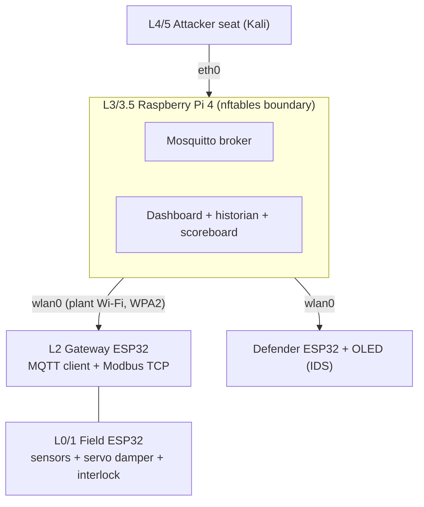

# Mini Purdue Plant: a hardware ICS/OT CTF

A miniature **equipment cooling room**, built as a small multi-device model of the Purdue
reference architecture and played as a Capture-the-Flag. Players assess it the way an OT
assessor would: **enumerate** what is exposed, **classify** it, find **writable points
reachable from the wrong level**, cause a **visible physical effect**, and then compare the
vulnerable build against a **hardened** one.

> **Status: Sprint 0 (documenting the existing build). Everything beyond the current
> single-ESP32 CTF is planned, not built.** Items marked *(unverified)* have not been
> checked against documentation or hardware yet.

> **Intentionally vulnerable.** The weaknesses in this project (plain HTTP, no
> authentication, flags stored in firmware, open broker permissions) are deliberate teaching
> material. Run it only on an isolated lab network, with fake credentials, on equipment you
> own or are authorized to test. Never expose it to the internet.

---

## Contents
1. [Purpose and users](#purpose-and-users)
2. [The process story](#the-process-story)
3. [Architecture](#architecture)
4. [Player progression](#player-progression)
5. [Frameworks and mapping](#frameworks-and-mapping)
6. [Roadmap (sprints)](#roadmap-sprints)
7. [Current build (Sprint 0 baseline)](#current-build-sprint-0-baseline)
8. [Hardware](#hardware)
9. [Safety and security rules](#safety-and-security-rules)
10. [Secrets and flag handling](#secrets-and-flag-handling)
11. [Planned repository layout](#planned-repository-layout)
12. [Working agreements](#working-agreements)
13. [Known limitations](#known-limitations)
14. [License and handling](#license-and-handling)

---

## Purpose and users
OT security concepts such as over-exposure, spoofed telemetry, missing authentication and
safe-state design are hard to show on slides. This project makes them tangible: a visitor
sees an attack change a physical "room," sees a defender detect it, and sees a hardened
build block it.

| User | What they get |
|---|---|
| Students (intermediate) | A hands-on assessment exercise using real tools (nmap, MQTT and Modbus clients) |
| Visiting sponsors | A 2-minute attract-mode demo of attack, detection and defense |
| Lab staff | A reproducible, documented testbed and a vulnerable-vs-hardened comparison |

**How we know it works:** each stage has a written test and a defined exit criterion, and a
first-time visitor can follow the attack, detection and hardening story without help.

## The process story
Used consistently in labels, dashboards and the demo script.

A **cooling room** keeps equipment from overheating.
- A real **temperature sensor** is the process variable.
- A **fan/damper** (servo) responds to temperature.
- An **over-temperature interlock** puts the system in a safe state.
- A **door contact** is the physical-access alarm.
- No water, level or flow sensors.

**Attack story:** spoof a cool reading and the room "overheats" while the dashboard says
all is well.

## Architecture
*Proposed; unverified until the relevant sprint completes.*

| Purdue level | Device | Role |
|---|---|---|
| L0/1 Field | ESP32-WROOM-32E field node | DS18B20 (temperature), BH1750 (light), reed switch (door), potentiometer on an ADC1 pin (setpoint), SG90 servo (damper, separate 5 V rail, common ground), LED bar, buzzer, status LEDs. Raspberry Pi Pico (non-W) optional as a wired L0 I/O node; Pico W optional as a rogue/inserted device |
| L2 Control | Second ESP32 | PLC/gateway: MQTT client plus Modbus TCP server |
| L3 / L3.5 | One Raspberry Pi 4 (8 GB) | Mosquitto, Grafana or Node-RED, time-series store, scoreboard. Plant Wi-Fi on `wlan0`, attacker/enterprise side on `eth0`, nftables enforces the boundary |
| L4/5 | Kali Linux seat (Pi or laptop) | Attacker seat with limited initial access |
| Defender | Existing ESP32 with OLED | IDS and the "operator face" |



**Design notes**
- The over-temperature **interlock lives in the field node firmware** (L0/1), so it works
  with no network and cannot be disabled over the network.
- Safe state on loss of communication.
- OPC-UA is a stretch goal on the Pi only. DNP3 and IEC 60870-5-104 are simulated on the Pi
  or discussed, not run on the ESP32.
- **Known limitation:** broker and firewall share one host, so the DMZ is logical. A second
  Pi can separate them later.

## Player progression
Stages 1-4 already exist as the web warm-up. Stages 5-12 are planned.

| Stage | Challenge | Concept |
|---|---|---|
| 1 | View page source | Information in HTML comments |
| 2 | robots.txt | Exposed hidden paths |
| 3 | Base64 string | Encoding is not encryption |
| 4 | HTTP response headers | `X-Flag` header on `/api/status` |
| 5 | Network discovery (nmap) | What is on the network |
| 6 | Browse the MQTT namespace | Enumerating exposed data |
| 7 | Read the gateway's Modbus data model | Observable points |
| 8 | Classify points | Read-only vs writable, ranked by criticality |
| 9 | Over-exposure | A `viewer` writes a point it should not |
| 10 | Physical impact | Spoof a sensor or change a setpoint; the interlock trips to a safe state |
| 11 | Defender / IDS | Detection of the attacks above |
| 12 | Hardened build | Replay all attacks; they fail by design |

Challenge design follows the enumerate, classify, check-exposure method from the course text
(*Operational_Technology_Cybersecurity*, ch. 8): browse the exposed model, separate
telemetry from writable points, rank by criticality, then confirm who can reach the writable
points.

## Frameworks and mapping
No sponsor-mandated framework applies to this project.

- **Backbone: ISA/IEC 62443**: zones and conduits, security levels 1-4, and the seven
  foundational requirements (IAC, UC, SI, DC, RDF, TRE, RA).
- **Technique tagging: MITRE ATT&CK for ICS**: technique names on every challenge and IDS
  alert. **IDs and the current version must be verified at attack.mitre.org; they are not
  guessed.** *(tracked in an issue)*
- **Reference: NIST SP 800-82 Rev. 3.** CSF 2.0 only as an optional one-line mapping.
- IEC 62443 text is paywalled; cite the course textbook and ISA public pages.

Planned mapping of stages to foundational requirements:

| Stage type | Foundational requirement |
|---|---|
| Discovery | RDF, DC |
| Over-exposure | UC, IAC |
| Spoofing | SI |
| Detection | TRE |
| Safe state and scan tolerance | RA |

## Roadmap (milestones and sprints)
Work is organized as **milestones (phases) > sprints > task issues**. Sprints are not time-based:
each ends when its exit criteria are met and the owner approves. Every task is sized
(S about 1 day, M about 3 days, L about 1 week) and labeled for where it can be done
(remote, lab hardware, lab network). See [docs/PROJECT_MANAGEMENT.md](docs/PROJECT_MANAGEMENT.md)
for the labels, issue format and how progress is tracked.

| Milestone | Sprint | Focus | Exit criterion (short) |
|---|---|---|---|
| **M1 - Baseline and platform** | 0 | Existing build baseline | Another person can rebuild and run it from the docs; all four levels pass a written test list |
| | 1 | Plant network and server foundation | ESP32 joins the plant network; nmap from Kali sees only intended hosts and ports; firewall rules documented and tested |
| **M2 - The plant** | 2 | Field node and sensors (stages 5-6) | Warming the sensor moves the dashboard; a bad sensor gives a fault state; MQTT-browse challenge works |
| | 3 | L2 gateway and the writable point (stages 7-9) | Discovery, data-model, classification and over-exposure challenges pass end to end; each maps to a 62443 FR and ATT&CK name |
| | 4 | Physical process and safety interlock (stage 10) | Spoofed values cause the visible effect; the interlock trips to a safe state; reset works |
| **M3 - Defend and harden** | 5 | Defender and scoreboard (stage 11) | Each attack raises the expected alert; no false alarms; no secrets in logs |
| | 6 | Hardened build (stage 12) | Replaying stages 5-10 fails as designed; each control maps to the attack it stops |
| **M4 - Demo and release** | 7 | Demo, docs, polish | A first-time visitor sees an attack, the detection and the hardened block |

Every sprint also updates: README, wiring/pin table, BOM, security notes, changelog,
decisions log, and the verified/unverified list.

**Current status:** Sprint 0. Done: concept and framework decisions, approved plan, repo and
issue tracking, README/plan published, bring-up check, and the existing CTF running (owner-observed).
Open: documenting and test-verifying the existing build, and deciding repo visibility and flag
handling (this repo is public).

## Current build (Sprint 0 baseline)
*Described from the owner's notes; being verified against the code in Sprint 0.*

A single ESP32 that joins the lab's private 2.4 GHz WPA2-Personal Wi-Fi as a client, gets an
address by DHCP, and serves plain HTTP on port 80 with hostname `ctf-esp32`. The IP address
is shown on the OLED while asleep and in the Serial Monitor.

| Endpoint | Purpose |
|---|---|
| `/` | CTF page |
| `/robots.txt` | Stage 2 |
| `/s3cr3t-backup.txt` | Hidden file named in robots.txt |
| `/api/status` | Stage 4 (response header) |
| `/submit` (POST) | Flag submission |

**OLED face:** sleeps (dimmed, closed eyes) after 60 s without web use; wakes on a page
request; taunts after a wrong flag; shows happy eyes after a correct one; reacts to
robots.txt, the hidden file and the status API. The footer shows the IP while asleep and
flags solved (n/4) while awake. Holding BOOT (GPIO0) for 3 s resets progress.

**Software:** Arduino IDE, board "ESP32 Dev Module", ESP32 Arduino core 3.3.8 (ESP-IDF
v5.5.4). Libraries: Adafruit SSD1306 and Adafruit GFX (versions not yet recorded), plus the
core's built-in WiFi, WebServer, SPI and mbedtls.

**Verified so far:** bring-up sketch serial output (ESP32-D0WD-V3 rev 3.01, 2 cores at
240 MHz, 4096 KB flash, ESP-IDF v5.5.4, steady heartbeat). The CTF sketch is owner-observed
working. **Not yet recorded:** a documented pass through every level, the maximum number of
simultaneous players, and long-run stability.

## Hardware
**Confirmed (current build)**
- ESP32-WROOM-32E module (chip ESP32-D0WD-V3 rev 3.01), 4 MB flash, on an extension board
  (GPIO16 and GPIO17 not broken out)
- 0.96" SSD1306 OLED, 128x64, SPI (7-pin)
- USB power and programming; onboard BOOT button (GPIO0)

OLED wiring *(owner notes; to be verified against the code)*

| OLED pin | ESP32 pin |
|---|---|
| GND | GND |
| VCC | 3V3 |
| D0 (SCK) | GPIO18 |
| D1 (MOSI) | GPIO23 |
| RES | GPIO4 |
| DC | GPIO26 |
| CS | GPIO5 |

**Proposed, not yet purchased or verified:** second and third ESP32 (gateway, field node),
DS18B20, BH1750, reed switch, potentiometer, SG90 servo with a separate 5 V supply, LED bar,
buzzer, status LEDs, Raspberry Pi 4 (8 GB) with SSD or high-endurance SD, optional Pico /
Pico W, Kali attacker seat.

**Pin-planning reminders for the field node:** analog inputs on ADC1 only, avoid flash pins,
watch strapping pins, GPIO34-39 are input-only. The pin plan is a Sprint 2 task.

## Safety and security rules
Priority order: **safety first, availability second, security third.**

- Private, isolated network only. Fake credentials only. Every weakness labeled "intentional".
- Low-voltage actuators only. No mains, relays or heaters without human review.
- Servo/actuator power is separate from the ESP32 3.3 V rail (common ground).
- The interlock cannot be disabled over the network; safe state on loss of communication.
- Only unclassified, public information goes in this repository or its issues. Follow the
  lab's and sponsor's handling rules; if unsure what is allowed, ask the lab lead.
- No real credentials, certificates or hostnames in code. Use an untracked secrets file with
  a committed example template, or Kconfig/NVS.
- Before enabling secure boot, flash encryption or touching eFuses: the tradeoffs are
  explained first, and permanent changes happen on a test unit only.

## Secrets and flag handling
- Wi-Fi credentials live in `arduino_secrets.h`, which is **git-ignored**. Only
  `arduino_secrets.h.example` (fake values) is committed.
- **Open decision:** the CTF flags are currently stored in firmware source. If this repository
  is public, anyone can read them. See the repo-visibility and flag-handling issue. The
  instructor answer key must not be committed to a public repository.
- Wrong flag attempts are written to the serial port. Logs must never contain secrets.

## Planned repository layout
*Planned; the folders appear as sprints land.*

```
.
├── README.md
├── docs/
│   ├── PROJECT_PLAN.md      approved plan (source of truth for scope)
│   ├── WIRING.md            pin tables and block diagrams
│   ├── BOM.md               parts, part numbers, sources
│   ├── SECURITY_NOTES.md    threat model, controls, out of scope
│   ├── TEST_PLAN.md         written tests with Pass/Fail/Date
│   ├── VERIFIED.md          what is verified vs unverified
│   ├── DEMO.md              2-minute demo guide
│   ├── CHANGELOG.md
│   └── DECISIONS.md         what was chosen and why
├── firmware/
│   ├── ctf_esp32/           existing CTF + OLED face (becomes the defender)
│   ├── ESP32_test/          bring-up check
│   ├── field_node/          Sprint 2+
│   └── gateway/             Sprint 3+
├── server/                  Pi configs: nftables, Mosquitto, dashboards (Sprint 1+)
└── .gitignore               must ignore arduino_secrets.h and any private answer key
```

## Working agreements
- **Plan before building.** A short plan is approved before each sprint; the owner approves
  before the next sprint starts.
- **Smallest viable change.** Preserve existing structure and behavior unless there is a
  clear, documented reason.
- **Diagnose before modifying.** Logs and serial output first; no random fixes.
- **Never invent** pins, libraries, options or technique IDs. Unverified items are labeled.
- **Docs are part of the deliverable.** Procedures state which parts were verified.
- **Authorized, defensive use only.** Testing is limited to devices the lab owns.

## Known limitations
- Single-threaded `WebServer` on the ESP32: the maximum number of simultaneous players is
  unmeasured (Sprint 0 test).
- Broker and firewall share one Pi, so the DMZ is logical (later sprint can split them).
- Library versions for the current build are not yet recorded.
- No secure boot or flash encryption on the current build; flags can be dumped by anyone
  with USB access to the device.

## License and handling
License: **[FILL IN: owner to choose]**. Handling: unclassified, public information only.
